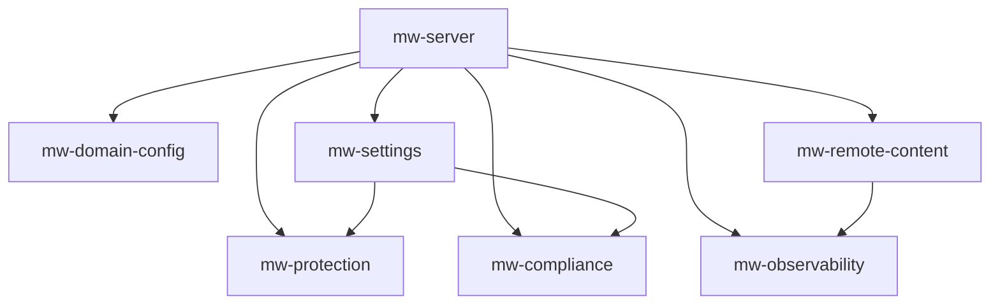

# Server crate boundaries

The server is split along independently testable service/model boundaries. This
is a compile-time organization change, not a deployment into six processes.
`mw-server` retains Axum routes, session authorization, application startup,
upstream orchestration and adapters to the shared application state.

| Crate | Owns | Kept in the server |
| --- | --- | --- |
| `mw-domain-config` | Endpoint/authentication/security contracts, EWS configuration, canonical identities, deterministic backend selection | Credential-free network probes, live connections and failover orchestration |
| `mw-settings` | Registry, knob catalog, bounds/defaults, preference validation and effective-policy resolution | Authenticated settings routes, account context and dedicated write handlers |
| `mw-protection` | Probe catalogs/classification, bounded user-agent matching, CIDR/trusted-proxy rules and geography validation | Middleware, socket peer extraction, authentication and enforcement orchestration |
| `mw-compliance` | Retention planning, breach workflow/report models and governance validation | Request/breach endpoints, notification dispatch and background job orchestration |
| `mw-remote-content` | Cache tiers, resizing, adaptive admission, fetch limits, policy builders and bounded counter history | Authorization/SSRF checks, HTTP handlers, revalidation orchestration and host-owned counter collection |
| `mw-observability` | Resource discovery/sampling, latency histograms, telemetry/analytics contracts and stack symbolication | Authenticated observation routes, server-specific response classification and metric persistence adapter |

The six crates do not depend on `mw-server` or its `AppState`. Compatibility
re-exports keep existing server call sites and integration tests on the same
concrete types. Pure logic has a single implementation; security checks are not
replaced by the cache extraction.



Existing low-level crates such as `mw-store`, `mw-net`, `mw-smtp` and `mw-egress`
remain shared dependencies. The folder-target parsing contract lives in
`mw-store::folder_target` so validating a setting does not depend on the entire
sync engine. The remote-content dependency of settings is test-only: registry
integration tests check cache defaults against their actual consumers.

Latency observations receive an explicit persistence callback from server
startup. History receives typed host counters from the adapter. These seams
preserve the existing gauges and durable aggregation without introducing a
reverse dependency on the application.

## Verification and measurement

Run the extracted regression suites independently:

```sh
cargo test -p mw-domain-config -p mw-settings -p mw-protection -p mw-compliance -p mw-remote-content -p mw-observability --lib -- --test-threads=1
cargo check -p mw-server --all-targets --timings
```

The workspace and Docker `rust-source` stage include all six crates. A server-only
source edit can reuse the extracted crate artifacts. Editing a shared API can
still rebuild downstream crates; adding crates alone does not guarantee a faster
cold build or increase runtime request throughput.

For a controlled comparison, use separate checkouts of the before/after commits
on the same host/toolchain with identical release flags and feature sets. Record
both a clean build and a warm rebuild after the same small server-only change.
Keep other compilers stopped and retain the Cargo timing reports. The first build
after this extraction changes crate fingerprints and must not be presented as a
warm-build speedup. See [build profiling](build-profile.md) and the deployment
[scalability limits](../deploy/scaling.md).

The generated configuration reference can now be refreshed without compiling the
HTTP server:

```sh
cargo run -p mw-settings --example render_docs -- docs/admin/configuration.md
```
