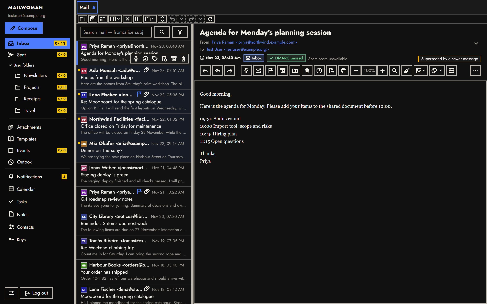
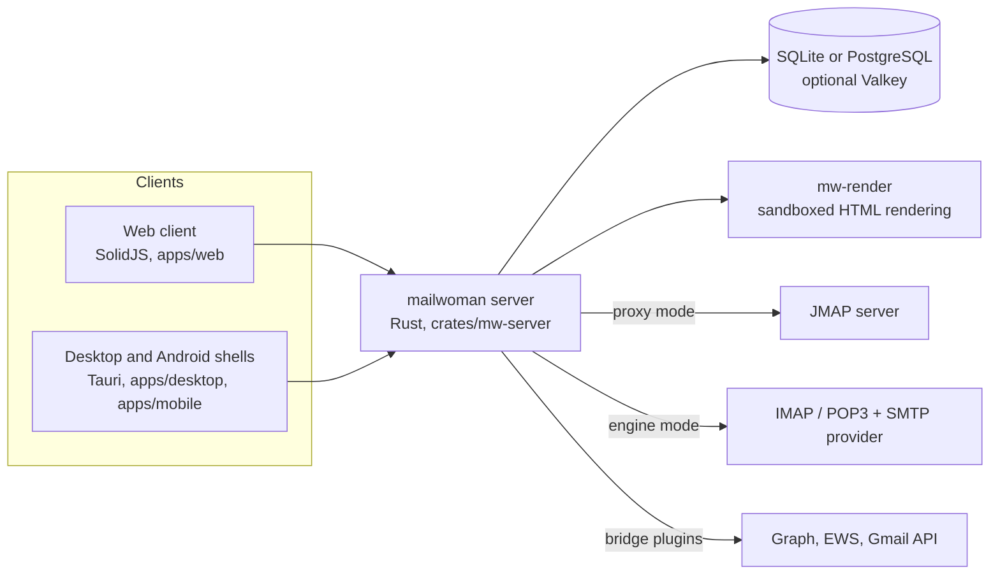

<div align="center">


# Mailwoman

**Self-hosted webmail and personal workspace for the mail accounts you already use.**

[](https://github.com/supermarsx/mailwoman/actions/workflows/ci.yml)
[](VERSIONING.md)
[](license.md)

[Features](#features) · [Quick start](#quick-start) · [Architecture](#architecture) · [Documentation](#documentation) · [Status](#project-status)

</div>

<p align="center">
  
  <br>
  <sub>The mailbox in the default dark theme. Demo data from the in-repo JMAP mock; all names and addresses are fictional.</sub>
</p>

Mailwoman puts email, calendars, contacts, tasks and encrypted notes into one
browser workspace. It does not replace your mail server: it connects to a JMAP
server, or uses its own engine to talk IMAP or POP3 and SMTP to an existing
provider. A Rust server serves a SolidJS web client; desktop and Android shells
wrap the same client.

## Features

**Mail**
- Folders and messages open in tabs, with a configurable reading pane, conversation grouping, bulk actions, follow-up flags, [snooze](docs/user/snooze.md) and saved searches.
- Compose in rich text, HTML or plain text, with signatures, resumable [drafts](docs/deploy/account-drafts.md) and scheduled sending where supported. [Compose formats](docs/deploy/compose-formats.md)
- An attachment browser with filters, PDF and image previews, and opt-in thumbnails. [Preview policy](docs/deploy/attachment-preview.md)
- Offline access and multiple windows. [Sync and offline](docs/user/sync-offline.md)

**Privacy and encryption**
- Messages render in a sandbox. Remote images and links are controlled per message or per sender. Authentication and delivery details can be inspected. [Privacy](docs/admin/privacy.md) · [Delivery status](docs/deploy/delivery-status.md)
- OpenPGP and S/MIME, with private-key operations in the browser. Optional zero-access storage. [Message encryption](docs/security/crypto.md) · [Zero-access storage](docs/security/zero-access.md)

**Workspace**
- Calendar and contacts next to mail, with CalDAV and CardDAV connections. [DAV setup](docs/deploy/caldav-carddav.md)
- Tasks, My Day and encrypted notes. A customizable ribbon, message list and reader.
- Light, dark and high-contrast themes.

**Connections**
- JMAP proxy mode, or engine mode over IMAP/POP3 and SMTP. [JMAP](docs/admin/jmap.md) · [IMAP/POP3](docs/deploy/imap-pop3.md)
- Bridges for Microsoft Graph, Exchange EWS and the Gmail API. [Bridges](docs/bridges/index.md)

**Administration**
- An admin console for deployment and account policies, sign-in protection, SSO and backups. [Settings reference](docs/admin/settings.md) · [SSO](docs/admin/sso.md) · [Backups](docs/deploy/backups.md)
- SQLite by default; PostgreSQL and Valkey for a full stack. [PostgreSQL](docs/deploy/postgres.md)
- WebAssembly engine plugins with an approval and capability model. [Plugins](docs/admin/plugins.md)
- An optional AI assistant with explicit endpoint, capability and data limits. [AI assistant](docs/admin/ai-assistant.md)

<details>
<summary><b>How it compares with other web clients</b></summary>

The Outlook row covers **Outlook on the web**. Availability can vary with the
edition, account, server, extensions and administrator policy.

| Web client | Hosting and mail connection | Workspace and workflow | Message encryption |
| --- | --- | --- | --- |
| **Mailwoman** | Self-hosted. JMAP proxy or engine with IMAP/POP3 and SMTP, plus provider bridges. | Mail, calendar, contacts, tasks and notes. Workspace tabs, follow-up flags and configurable actions. | Browser-side OpenPGP and S/MIME. [Connection guide](docs/admin/jmap.md) · [Crypto guide](docs/security/crypto.md) |
| **Outlook on the web** | Microsoft 365 / Exchange Online, with web access also available in Exchange Server deployments. | Mail, calendar and People. Inbox tools include Sweep and Archive. | S/MIME or Microsoft Purview Message Encryption, depending on account and policy. [People](https://support.microsoft.com/en-us/outlook/using-contacts-people-in-outlook-on-the-web) · [Calendar](https://support.microsoft.com/en-us/outlook/calendar-sharing-in-microsoft-365) · [Inbox tools](https://support.microsoft.com/en-us/outlook/organize-your-inbox-with-archive-sweep-and-other-tools-in-outlook-on-the-web) · [Encryption](https://support.microsoft.com/en-us/outlook/mail/learn-about-securing-and-protecting-email-messages-in-outlook) |
| **RainLoop** | Self-hosted PHP webmail for IMAP/SMTP. The original repository is archived. | Email-focused interface with contacts and support for multiple accounts. | Client-side OpenPGP. [Features](https://www.rainloop.net/features/) · [Repository](https://github.com/RainLoop/rainloop-webmail) |
| **SnappyMail** | Self-hosted PHP webmail for IMAP/SMTP. A fork of RainLoop. | Mail, contacts, identities and Sieve filtering. | OpenPGP. [Project](https://github.com/the-djmaze/snappymail) · [Feature comparison](https://snappymail.eu/comparison) |
| **Roundcube** | Self-hosted PHP webmail for IMAP/SMTP. | Mail and address books with a plugin ecosystem. | PGP support. [Project features](https://roundcube.net/about/) |
| **Bulwark** | Self-hosted JMAP webmail focused on Stalwart. A separate Legacy Proxy can connect an existing IMAP stack. | Mail, calendar, contacts and files in one client. | OpenPGP through an extension. [Project](https://bulwarkmail.org/) · [OpenPGP extension](https://extensions.bulwarkmail.org/extension/openpgp) |

</details>

## Quick start

### Deploy with Docker

On a Linux host with Git, Bash 4+, Docker and Compose 2.30+, from the repository root:

```sh
bash deploy.sh --domain mail.example.org --mode engine
```

- `--domain` publishes the app through Caddy with automatic HTTPS. Point the domain at the host and allow ports 80 and 443. Omit it for a local HTTP deployment on the first free port from 8080.
- `--mode engine` connects to IMAP/POP3 and SMTP. Omit it for JMAP proxy mode.
- `--prebuilt` pulls the published `ghcr.io/supermarsx/mailwoman:master` image instead of building locally.

The script also handles updates, backups, restore and rollback (`bash deploy.sh --help`).
Prerequisites, upstream configuration and every option are in the
[deployment guide](docs/deploy/script.md).

### Try it locally against the demo backend

The dev Compose file builds the server and the in-repo JMAP mock used by the end-to-end tests:

```sh
docker compose -f docker-compose.dev.yml up -d --build mock mailwoman
```

Open <http://localhost:8080> and sign in as `testuser@example.org` / `testpass`.

### Develop

Prerequisites: the Rust toolchain pinned in `rust-toolchain.toml`, Node.js and pnpm 11.

```sh
# JMAP mock on :8181
cargo run -p mw-mock-jmap

# Server on :8080, proxying to the mock
MW_SERVER_KEY=$(openssl rand -hex 32) MW_COOKIE_SECURE=false \
MW_JMAP_UPSTREAMS=http://127.0.0.1:8181 \
MW_UPSTREAM_DEFAULT=http://127.0.0.1:8181/.well-known/jmap \
cargo run -p mw-server --bin mailwoman -- serve

# Web client with hot reload on :5173 (proxies /api and /jmap to :8080)
pnpm -C apps/web install
pnpm -C apps/web dev
```

On Windows, a debug build of the server can overflow the default 2 MiB worker
thread stack; set `RUST_MIN_STACK=67108864` when running it.

Read [engineering practices](docs/engineering-practices.md) before your first change.

## Configuration

Server settings come from environment variables (`MW_*`) at startup and from the
admin console at runtime.

- [Configuration reference](docs/admin/configuration.md) and [settings reference](docs/admin/settings.md)
- [Reverse proxy](docs/deploy/reverse-proxy.md) · [TLS / ACME](docs/deploy/acme.md) · [Hardening](docs/deploy/hardening.md)
- [Domain providers](docs/admin/domain-providers.md) · [LDAP](docs/deploy/ldap.md) · [SSO](docs/admin/sso.md)

## Architecture



- **`crates/`**: the Rust workspace. `mw-server` is the HTTP server and the `mailwoman` binary; `mw-engine`, `mw-imap`, `mw-pop3` and `mw-smtp` implement engine mode; `mw-store` holds persistence; `mw-sanitize` and `mw-render` handle untrusted HTML; `mw-crypto`, `mw-sso`, `mw-mfa` and `mw-plugin` cover their areas.
- **`apps/web`**: the web client (SolidJS, Vite, vanilla-extract). **`apps/desktop`**, **`apps/mobile`**: Tauri shells.
- **`plugins/`**: first-party plugins (provider bridges, spam trainers, Nextcloud, masked email).
- **`packaging/`**, **`deploy/`**: Helm, Flatpak, winget, F-Droid, systemd and fail2ban material.

The [technical specification](SPEC.md) describes the full design, including what is cut or not yet built.

## Documentation

The manual lives in [`docs/`](docs/README.md) and builds into a searchable site (`pnpm install && pnpm dev` in `docs/`).

| If you want to… | Start here |
| --- | --- |
| Install, update or restore a deployment | [Deployment guide](docs/deploy/script.md) · [Backup and recovery](docs/deploy/backups.md) |
| Configure mail providers and accounts | [JMAP](docs/admin/jmap.md) · [IMAP/POP3 and SMTP](docs/deploy/imap-pop3.md) · [Bridges](docs/bridges/index.md) |
| Review security and privacy | [Security model](docs/security/README.md) · [Hardening](docs/deploy/hardening.md) · [Privacy](docs/admin/privacy.md) |
| Set up desktop or mobile clients | [Desktop](docs/deploy/desktop.md) · [Android](docs/deploy/mobile-android.md) |
| Use the app day to day | [Sync and offline](docs/user/sync-offline.md) · [Unified mail](docs/user/unified-mail.md) · [Snooze](docs/user/snooze.md) |

## Project status

Mailwoman is under active development. Feature availability depends on the
deployment mode, the provider's capabilities and administrator policy.

Releases use a rolling **`YY.N`** scheme with bare git tags (`26.18`, `26.19`, …);
`N` resets each calendar year and package manifests use `YY.N.0`. The release
history, including later corrections, is in [VERSIONING.md](VERSIONING.md).

## Security

Report vulnerabilities privately through GitHub's private vulnerability
reporting, not in a public issue. [SECURITY.md](SECURITY.md) covers the process,
supported versions and the scope of Mailwoman's security properties.

## Contributing

Issues and pull requests are welcome. Before a change, read
[engineering practices](docs/engineering-practices.md); the test and coverage
gates are described under [`docs/testing/`](docs/testing/coverage.md).

## License

Mailwoman is released under the [MIT license](license.md).
